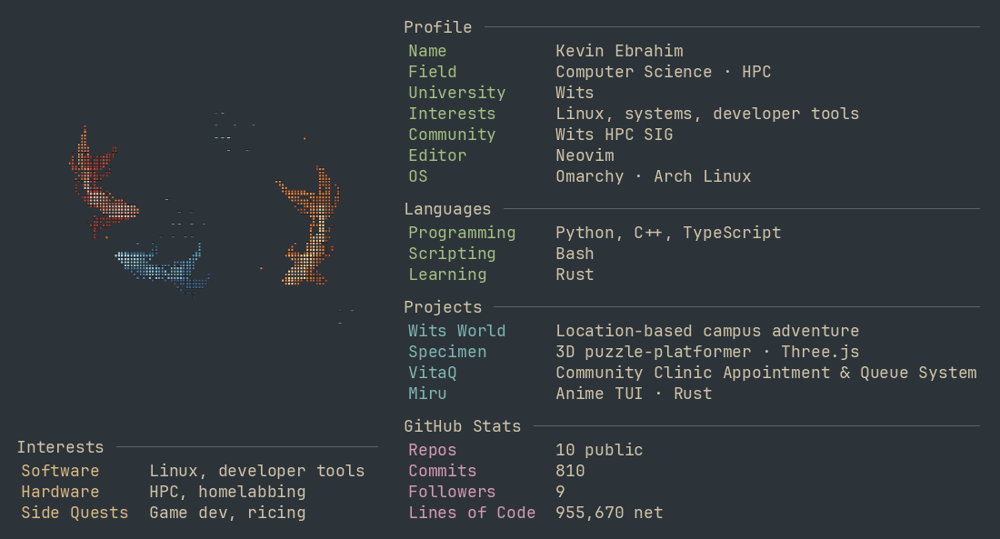

<picture>
  <source media="(max-width: 640px)" srcset="./assets/profile-mobile.gif">
  
</picture>

[koi-fetch](https://github.com/Kevin-Ebrahim/koi-fetch) · [miru](https://github.com/Kevin-Ebrahim/miru) · [gh-tune](https://github.com/Kevin-Ebrahim/gh-tune)
